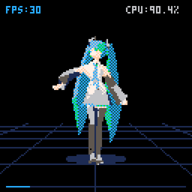
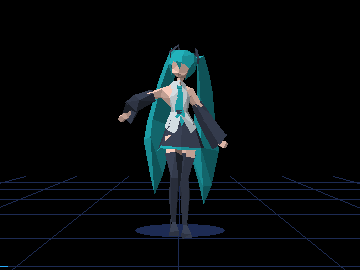

# Miku — shared PICO-8 / Picotron example

A one-minute **Hatsune Miku dance demo for PICO-8 Education 0.2.7**.
It plays retargeted **MMD (MikuMikuDance) skeletal animation** on a
**387-vertex, 597-triangle** low-poly Miku model, accompanied by a
four-channel instrumental chiptune arrangement of *Miku* by Anamanaguchi
feat. Hatsune Miku.

The demo uses **pico8mcp's multicart API** to load four cartridges: one for
the player, model and music, and three for compressed dance motion. Motion
is preloaded before playback, interpolated from 30 Hz bone samples and
synchronized to the native music clock. A fixed front camera follows the
full body, with live Verlet physics for the pigtails and tie.



The top corners show native **FPS** (`stat(7)`) and **CPU %** (`stat(1)`),
sampled after rendering. CPU is the percentage of the PICO-8 VM frame budget.

### Stored motion and music

| Data | Stored samples | Playback |
| --- | --- | --- |
| Skeletal motion | **1,801 unique poses at 30 Hz**, covering 1,800 intervals / 60 seconds | Root position is interpolated linearly; bone angles interpolate along the shortest wrapped rotation. |
| Instrumental music | **512 tracker rows**, arranged as **16 patterns of 32 rows**, with **4 voices** / 2,048 note-or-rest slots | PICO-8's native synth plays the note data; these are musical steps, rather than video frames or recorded audio samples. |
| Pigtails and tie | No stored secondary-motion frames | Verlet physics runs in fixed **60 Hz** steps. |

The motion is split into 15 four-second blocks of 121 poses. Shared block
endpoints duplicate 14 poses, so the cartridge data contains **1,815 pose
records** in total. Each pose stores root XYZ and XYZ rotations for 20 bones
(63 channels). The rendered frame rate does not change the stored sample
count: the music clock selects the interpolated pose on each update.

## Picotron version

Use **`play.cmd -target picotron`** (or `sh play.sh -target picotron`).
`play.cmd -target pico8` selects the original four-cart version; omitting
`-target` also selects PICO-8.

The native version uses the Picotron **JS/WASM browser VM at 480×270**, with
solid palette shading, the same fixed front-follow camera, and live
pigtail/tie physics. It targets **30 FPS**. `player.lua` is shared between
both builds; `miku_picotron.lua` supplies the native asset, viewport and
music-clock callbacks. Reusable methods live in the SDK's `picotron.lua`.



This is a **separate three-second animated PNG**, cropped to **360×270**.
The game itself remains 480×270. The PICO-8 preview above is unchanged.
README previews are not included in cartridge ROMs.

The existing **1,800 motion intervals / 1,801 unique 30-Hz poses** and all
**512 four-channel tracker rows** are reused. Four-second overlap records
remain unchanged, and the build verifies all 15 motion checksums and all
2,048 converted note/rest words. The native synthesizer uses equivalent
waveforms/effects; its sound is not a bit-exact PICO-8 synth emulation.
No new dance samples, MIDI arrangement, recorded vocals or audio samples
are introduced.

`build_picotron.py` converts the existing Lua asset tables into native typed
POD data and packs one **~169 KiB P64 ROM**, below Picotron's 256 KiB limit.
This build is dependency-free Python and does not run ZX0 or Shrinko8.
Outputs go to ignored `build-picotron/`; playback evidence goes to
`debug/picotron/`. The launcher verifies non-silent native audio as well as
motion integrity. Its CPU monitor shows the fraction of the **30-FPS**
budget, while FPS counts rendered application frames.

The current export player's synth advances at 120 ticks/second, compared
with the source PICO-8 arrangement's 128. Retaining the original tracker
speed makes the source minute play in approximately **64 seconds** here;
motion remains locked to the music clock. The source timing data has not
been re-gridded to hide that difference.

## Run

Run `python pico8_mcp.py --setup` from the repository root once. Then use
**play.cmd** on Windows or **sh play.sh** on Linux/macOS. The launcher builds
four carts from Lua sources and runs them through pico8mcp's public bundle
API. Python 3.10+ and an existing Chrome/Edge/Chromium are required.
ZX0 compression/decompression is pure Python; no tool executables or
generated cartridges are bundled in this source example.

## Files

- `miku.lua`: integer model tables and four-channel native music words.
- `miku_a.lua`, `miku_b.lua`, `miku_c.lua`: integer animation deltas.
- `player.lua`: the renderer, animation, audio clock and Verlet physics.
- `zx0.lua`: the upstream decoder and its license notice.
- `data_loader.lua`: shared preload code for the three animation carts.
- `build_picotron.py`, `miku_picotron.lua`, `picotron_player.py`: native build and adapter.
- `build.py`: PICO-8 build entry point; `build_lua.py`: Miku-specific packing.
- `play.py`, `play.cmd`, `play.sh`: build, stage all four carts and play.

Data format comments appear above the model, music and animation tables.
Shared code uses `#include`; it is flattened into the generated carts.
Face normals are calculated once on preload, then retained for lighting.
All model, motion and music data needed to build this example is in its Lua sources.

## Commands

```text
play.cmd -target pico8
play.cmd -target picotron
python build.py
play.cmd --headless --duration 8
```

Generated carts go in `build/carts/`. Browser profiles/evidence go in
`debug/`; both folders are ignored by Git. A cold pure-Python compression
pass can take several minutes (about 11 minutes in the full comparison test).
Unchanged streams are cached, and unchanged builds start without recompression.
Build outputs are regenerated when a source, include or builder changes. No `.p8` files are
included in this source distribution.


To run through MCP after building, start a server rooted at this example:

```json
{"name":"pico8_load_bundle","arguments":{
  "entry":"build/carts/miku.p8",
  "carts":["build/carts/miku_a.p8","build/carts/miku_b.p8","build/carts/miku_c.p8"]
}}
```

Then call `pico8_run {}`. The data carts use `LOAD` and `CSTORE` to prepare
the motion caches. The main cart reads them with `RELOAD` and caches all
15 decoded blocks before playback. Ready GPIO starts with `77,75,1`;
the launcher verifies all motion checksums and checks for underflows.

The source helpers come from this checkout by default. `PICO8_MCP_SOURCE`
can select another helper directory, and `PICO8_MCP_HOME` selects the shared
runtime/cache location. Standalone copies can use an installed pico8mcp.

## Credits and provenance

**Music:** *Miku* by Anamanaguchi feat. Hatsune Miku.
Instrumental note arrangement: [creamil / Online Sequencer 2492007](https://onlinesequencer.net/2492007).

**Motion:** Motion by UT AET Department @ LIM Lab / Ten / Nechronyx / Nabix.

**Miku Motion Actor:** Diane Guo.

Motion made for Mikufest at Komoricon **“miku.fest40”**.
The supplied VMD retarget/facial work is credited to Durles in the original
package; this demo uses skeletal motion without facial animation.

**Original Model 3:** [*Low poly Miku Hatsune*](https://sketchfab.com/3d-models/low-poly-miku-hatsune-b944f4d0561641f2954fcd4f9424e27f)
by **emanueler**, Sketchfab, 2021; source license: CC Attribution-NonCommercial.
**Sly_i's Scratch adaptation:** modifications for modesty and polygon-count
reduction. This demo adds PICO-8 packing and rendering.

**ZX0 format/compressor:** [Einar Saukas](https://github.com/einar-saukas/ZX0), BSD-3-Clause.

**PICO-8 ZX0 decoder:** [Nat Pryce](https://github.com/npryce/ZX0-Pico-8), BSD-3-Clause.

**Current build:** the shared pure-Python ZX0 codec compresses motion data.
Lua code is assembled into `.p8` files without minification.

Scanline filling, linked depth buckets, skinning, cache scheduling and Verlet
integration are local implementations of standard methods. Their Lua
comments distinguish source data, upstream code and benchmark references.
